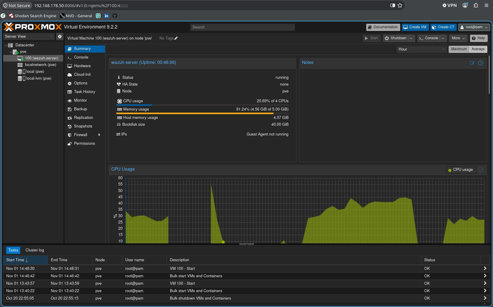
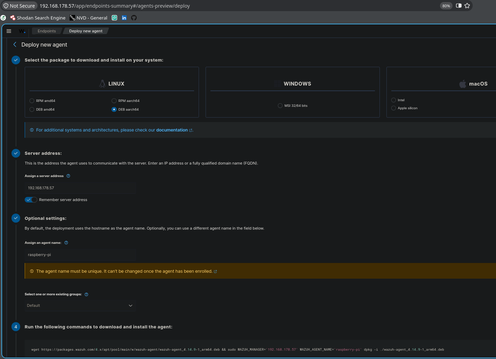

# Enterprise SIEM Deployment, Threat Detection & Compliance Lab (Wazuh on Proxmox VE)

An end-to-end implementation of an **Enterprise Security Information and Event Management (SIEM)** and **XDR** environment using **Wazuh 4.14** and **OpenSearch**, deployed as a dedicated KVM Virtual Machine on a Bare-Metal Proxmox Hypervisor.

This project showcases practical engineering skills in **virtualization, cross-architecture log shipping (x86_64 to aarch64), real-time threat detection mapped to the MITRE ATT&CK framework, and automated compliance auditing using CIS Benchmarks**.

---

## 🏗️ Architecture & Hypervisor Provisioning

- **Hypervisor:** Proxmox VE 9.2.2 running on dedicated hardware with native battery redundancy (integrated UPS)
- **SIEM Appliance (KVM VM 100):** Ubuntu Server 24.04 LTS
  - **Specs:** 4 vCPUs, 5.00 GiB RAM (~91% utilization with active OpenSearch indexing), 40 GiB storage
  - **Stack:** Wazuh Manager (Rule Engine), Wazuh Indexer (OpenSearch), Wazuh Dashboard (HTTPS / Port 443)
- **Monitored Endpoint (Agent 001):** Raspberry Pi 3B+ (ARM64 / Debian GNU/Linux 13, IP: `192.168.178.37`)

---

## 🚀 Cross-Architecture Agent Enrollment (ARM64)

The agent was deployed to a remote physical ARM64 Linux node:
- Configured via the deployment assistant using the **`DEB aarch64`** package architecture.
- Enrolled with the central Wazuh Manager at `192.168.178.57` over mutual TLS encryption.

Once connected, bidirectional telemetry was established, feeding system inventory, live events, and compliance scans into the manager:

---

## 🛡️ Threat Simulation & MITRE ATT&CK Real-Time Detection

### Scenario: SSH Brute-Force & Credential Access
To evaluate the detection and correlation pipeline, an authentication attack was simulated against the endpoint over SSH:
- Target: `pi@192.168.178.37`
- Execution: Repeated automated authentication attempts using invalid credentials and non-existent accounts.

### Correlation & Tactic Mapping
The Wazuh Agent intercepted auth failures from `/var/log/auth.log` and forwarded events to the analysis engine. The alerts were automatically mapped against the **MITRE ATT&CK Enterprise Matrix**:

- **Tactics Identified:**
  - `Credential Access` (17 events)
  - `Lateral Movement` (10 events)
  - `Privilege Escalation` & `Defense Evasion` (Sudo caching analysis)

- **Specific Techniques Triggered:**
  - **T1110.001:** *Brute Force: Password Guessing* (15 occurrences)
  - **T1021.004:** *Remote Services: SSH* (10 occurrences)
  - **T1110:** *Brute Force* (General rule threshold triggers)
  - **T1548.003:** *Abuse Elevation Control Mechanism: Sudo and Sudo Caching*

---

## 🔍 Hardening & Compliance Auditing (CIS Benchmark)

Beyond reactive alert monitoring, proactive system posture was evaluated using the **Security Configuration Assessment (SCA)** module:
- Evaluated against the **Center for Internet Security (CIS) Debian Linux 13 Benchmark**.
- Assessed **207 security controls** (e.g., partition mount parameters `nodev`, `nosuid`, `noexec`, and system daemon hardening).
- Real-time audit score: **42% compliance** with detailed remediation guidance for failed checks.

---

## 🛠️ Key Engineering & Troubleshooting Highlights

1. **Dynamic Storage Expansion:** Overcame the default Ubuntu LVM installer ceiling (`disk full error` during dashboard extraction) by resizing the logical volume and expanding the ext4 filesystem on the fly (`lvextend -l +100%FREE` & `resize2fs`).
2. **Service State Cleanups:** Resolved a crash in Filebeat caused by leftover keystores from previous installation attempts by performing full state and certificate purges.
3. **Architecture-Aware Packaging:** Handled binary incompatibilities by ensuring `aarch64` binaries were deployed to the ARM64 edge node rather than standard `amd64` builds.
